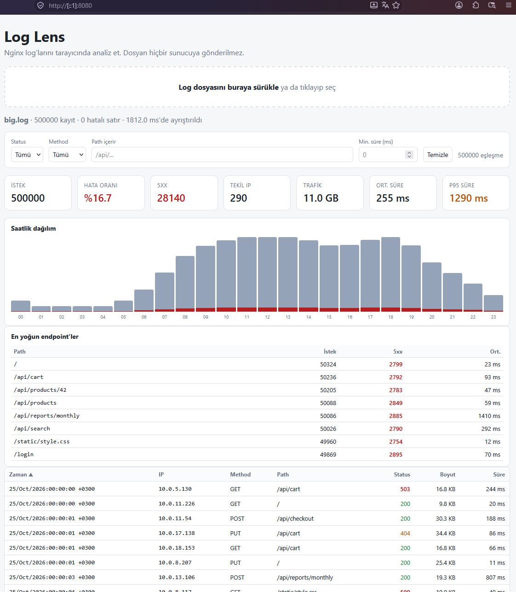
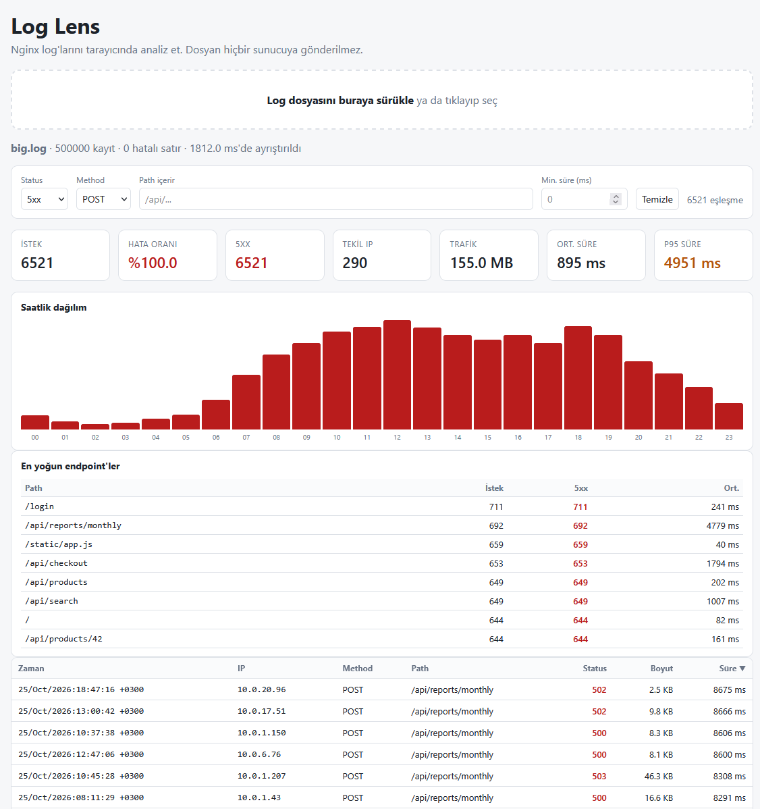

# Log Lens

Nginx access log'larını **tamamen tarayıcıda** analiz eden, Rust + [Leptos](https://leptos.dev) ile yazılmış bir WebAssembly uygulaması. Log dosyası hiçbir sunucuya gönderilmez.

## Çalıştırma

```bash
rustup target add wasm32-unknown-unknown
cargo install --locked trunk
trunk serve --open

# release modda çalıştırmak için
trunk serve --release --open
```

Test verisi üretmek için:

```bash
python3 tools/logs_gen.py 500000 > samples/big.log
```

## Performans

### Native ölçümler (criterion)

Ayrıştırma, filtreleme ve istatistik kodu UI'dan bağımsız olduğu için tarayıcı olmadan, [criterion](https://crates.io/crates/criterion) ile ölçülebiliyor. Bu ölçümler kodun kendi hızını gösterir; tarayıcıdaki (WASM) süreler ayrıca ölçülmelidir.

Tek komutla girdi dosyalarını üretip benchmark'ları çalıştırmak ve aşağıdaki tabloyu güncellemek için:

```bash
python tools/bench_native.py               # veri üret + cargo bench + README'yi güncelle
python tools/bench_native.py --skip-bench  # sadece son sonuçlardan tabloyu yeniden yaz
```

- Girdiler `tools/logs_gen.py` ile (seed 42) üretilen 10.000, 100.000 ve 500.000 satırlık `samples/bench_*.log` dosyalarıdır.
- Benchmark kodu: [`benches/native.rs`](benches/native.rs). Sadece `cargo bench` ile de çalıştırılabilir (girdi dosyaları önceden üretilmiş olmalı).
- Grafikli ayrıntılı rapor: `target/criterion/report/index.html`
- Ölçüm sırasında dizüstü bilgisayarı prize takılı tutmak ve diğer uygulamaları kapatmak sonuçları daha kararlı hale getirir.

<!-- BENCH-NATIVE:START -->
| İşlem | 10.000 satır | 100.000 satır | 500.000 satır |
|---|---:|---:|---:|
| Ayrıştırma (parse_all) | 4.14 ms | 50.73 ms | 243.59 ms |
| Filtreleme (5xx + checkout) | 8.6 µs | 180.8 µs | 1.83 ms |
| Path araması (checkout) | 11.0 µs | 260.5 µs | 2.25 ms |
| Özet istatistik (summarize) | 74.1 µs | 1.10 ms | 6.53 ms |
| Saatlik dağılım (hourly) | 19.9 µs | 219.5 µs | 1.90 ms |
| Top endpoint'ler (top_endpoints) | 22.2 µs | 249.0 µs | 2.86 ms |
| Ayrıştırma hızı | 2.4 M satır/sn | 2.0 M satır/sn | 2.1 M satır/sn |

- **Tarih:** 2026-10-28
- **CPU:** 12th Gen Intel(R) Core(TM) i7-1255U
- **İşletim sistemi:** Windows 11 (AMD64)
- **Derleyici:** rustc 1.98.0 (88d9e12ae 2026-08-18), `bench` profili (release + LTO)
- **Veri:** `tools/logs_gen.py` (seed 42), değerler criterion medyanıdır
<!-- BENCH-NATIVE:END -->

### Tarayıcı ölçümleri (Firefox, uçtan uca)

Uygulamanın release build'i [Playwright](https://playwright.dev) ile headless Firefox'ta açılır, aynı `samples/bench_*.log` dosyaları yüklenir ve kullanıcının gördüğü süreler ölçülür. Uygulama; dosya okuma (`File.arrayBuffer()`), JS'ten WASM'a byte kopyası ve ayrıştırma adımlarını `performance.measure` ile (`loglens:read`, `loglens:copy`, `loglens:parse`) işaretler; bu ölçümler Firefox profiler'ında da görünür.

İlk kurulum (bir kez):

```bash
npm install
npx playwright install firefox
```

Ölçüm:

```bash
npm run bench                         # trunk build --release + ölçüm + README güncelleme
npm run bench -- --skip-build         # mevcut dist/ ile ölç
npm run bench -- --runs 7 --headed    # daha fazla tur, tarayıcıyı görerek
npm run bench -- --browser chromium   # başka motorla karşılaştırma (README güncellenmez)
```

- Her boyut için 1 ısınma + 5 ölçüm turu yapılır, her tur yeni bir sekmede başlar; tabloda medyan değerler yer alır.
- "→ ekranda" süreleri, olay tetiklendikten sonra iki animasyon karesi geçene kadar, yani sonuç boyanana kadar ölçülür. Bu yöntemin alt sınırı 60 Hz'de yaklaşık 1–2 karedir (~16–33 ms); bu aralıktaki değerler kullanıcı için "anında" demektir ve küçük farklar ölçüm gürültüsüdür.
- Native satırı ve WASM / native oranı, `python tools/bench_native.py` ile alınan son criterion sonuçlarından okunur.
- Firefox varsayılan olarak `performance.now()` hassasiyetini düşürür; ölçüm sırasında `privacy.reduceTimerPrecision` kapatılır.

<!-- BENCH-BROWSER:START -->
| Ölçüm | 10.000 satır | 100.000 satır | 500.000 satır |
|---|---:|---:|---:|
| Dosya okuma (`File.arrayBuffer()`) | 4.74 ms | 37.7 ms | 191 ms |
| JS → WASM kopyası (byte kopyası + UTF-8 doğrulama) | 0.86 ms | 6.68 ms | 34.6 ms |
| Ayrıştırma (WASM, parçalı) | 11.7 ms | 92.7 ms | 383 ms |
| İlk çizim (Memo'lar + DOM + boyama) | 24.9 ms | 33.7 ms | 38.1 ms |
| Dosya seçimi → panel ekranda | 42.9 ms | 169 ms | 660 ms |
| Status filtresi (5xx) → ekranda | 20.0 ms | 24.9 ms | 23.5 ms |
| Path araması (checkout) → ekranda | 36.9 ms | 37.1 ms | 37.3 ms |
| Native ayrıştırma (criterion) | 4.14 ms | 50.7 ms | 244 ms |
| WASM / native ayrıştırma oranı | 2.82× | 1.83× | 1.57× |

- **Tarih:** 2026-10-28
- **Tarayıcı:** Firefox 157.0 (Playwright 1.64.1, headless: true)
- **CPU:** 12th Gen Intel(R) Core(TM) i7-1255U
- **İşletim sistemi:** Windows 11 (build 26300, x64)
- **.wasm boyutu:** 530 KB (gzip: 178 KB)
- **Yöntem:** 5 ölçüm + 1 ısınma turu, her tur yeni sekme; değerler medyandır. Ayrıştırma, UI'ı dondurmamak için parçalar arasında tarayıcıya kontrol verdiğinden native süreyle birebir aynı iş değildir.
<!-- BENCH-BROWSER:END -->

### İki sürümü karşılaştırma (A/B)

Ayrı zamanlarda yapılan ölçümler arasındaki %10–20'lik farklar ölçüm koşullarından (güç modu, sıcaklık, arka plan işleri) kaynaklanabilir. Bir değişikliğin gerçekten hızlandırıp hızlandırmadığını görmek için iki sürüm aynı Firefox oturumunda dönüşümlü olarak ölçülür:

```bash
npm run bench:ab -- 34e3d75 HEAD                          # iki commit
npm run bench:ab -- HEAD .                                # son commit ile commit edilmemiş değişiklikler
npm run bench:ab -- 34e3d75 HEAD --runs 15 --size 100000
```

- Her ref `.bench-ab/` altında geçici bir git worktree'ye alınır ve release olarak derlenir; iş bitince worktree silinir (`--keep` ile tutulur).
- 1 ısınma + 10 tur yapılır; her turda iki sürümün sırası değiştirilir (A B, B A, ...). Tablo medyanları, farkı ve B'nin kaç turda daha hızlı olduğunu gösterir.
- Yalnızca ölçüm noktaları olan sürümler (`8345d5c` ve sonrası) karşılaştırılabilir. README güncellenmez.

### Optimizasyon günlüğü

Her adım ayrı bir commit; değerler 500.000 satırlık sütundan (medyan). Native satırlar criterion, diğerleri Firefox ölçümüdür.

| # | Değişiklik | Ölçüm | Önce | Sonra |
|---|---|---|---:|---:|
| 1 | `File.text()` yerine `File.arrayBuffer()`: UTF-8 → UTF-16 → UTF-8 dönüşümleri yerine tek byte kopyası | Dosya okuma | 281 ms | 152 ms (−%46) |
| | | JS → WASM kopyası | 176 ms | 29.1 ms (−%83) |
| | | Dosya seçimi → panel ekranda | 924 ms | **589 ms (−%36)** |
| 2 | İstatistikler: SipHash yerine `FxHash` (rustc-hash), p95 için tam sıralama yerine `select_nth_unstable` | `summarize` (native) | 21.34 ms | 13.58 ms (−%36) |
| | | `top_endpoints` (native) | 18.20 ms | 16.23 ms (−%11) |
| | | İlk çizim (Memo'lar + DOM + boyama) | 98.8 ms | 74.9 ms (−%24) |
| | | Dosya seçimi → panel ekranda | 589 ms | **544 ms (−%8)** |
| | | Path araması → ekranda | 57.7 ms | 57.5 ms (değişim yok) |
| 3 | Path interning: her farklı path bir kez saklanır, kayıtlar sadece numarasını tutar (`PathTable`); path araması farklı path başına bir kez yapılır, `top_endpoints` hash tablosu yerine dizi sayacı kullanır | Path araması → ekranda | 57.5 ms | **37.3 ms (−%35)** |
| | | `top_endpoints` (native) | 16.23 ms | 3.75 ms (−%77) |
| | | Filtreleme, 5xx + checkout (native) | 6.46 ms | 2.92 ms (−%55) |
| | | İlk çizim (Memo'lar + DOM + boyama) | 74.9 ms | 53.2 ms (−%29) |
| | | Ayrıştırma (native) | 282.08 ms | 285.39 ms (≈ aynı) |
| | | Dosya seçimi → panel ekranda | 544 ms | 573 ms (+%5)¹ |
| 4 | Tüm metin alanlarını numaralandırma: IP, method, user agent, tarih ve saat dilimi de `Tables` içinde bir kez saklanır, kayıt tamamen sayılardan oluşur (heap ayırması yok, ~56 byte) | Ayrıştırma (native) | 285.39 ms | 243.59 ms (−%15) |
| | | `summarize` (native) | 14.54 ms | 6.53 ms (−%55) |
| | | Ayrıştırma (Firefox) | 323 ms | 383 ms (+%19)² |
| | | Dosya seçimi → panel ekranda | 573 ms | 660 ms (+%15)² |
| 5 | Sadece gösterilen alanları kopyalamamak: zaman damgası ve user agent kayıtta tutulmaz, ekrandaki satırlar dosya metninden yeniden okunur; hash araması satır başına 6'dan 2'ye iner, küçük tablolarda düz tarama | Ayrıştırma (Firefox, A/B: 3. adıma karşı) | 335 ms | 344 ms (fark yok, 5/10 tur)³ |
| | | Dosya seçimi → panel ekranda (A/B: 3. adıma karşı) | 582 ms | 589 ms (fark yok, 3/10 tur)³ |
| | | Ayrıştırma (native) | 243.59 ms | _ölçülecek_ |
| 6 | Byte düzeyinde, tek geçişli ayrıştırıcı: `split_*` yineleyicileri ve standart sayı ayrıştırıcıları yerine `memchr` ile ayraç arama ve elle sayı çevirme; eski ayrıştırıcı testlerde referans olarak tutulur, sonuçlar birebir aynı | Ayrıştırma (Firefox, A/B: 5. adıma karşı) | 292 ms | **263 ms (−%10, 10/10 tur)**⁴ |
| | | Dosya seçimi → panel ekranda (A/B) | 505 ms | 481 ms (−%5, 8/10 tur)⁴ |
| | | Ayrıştırma (native) | _5. adımın ölçümü_ | _ölçülecek_ |

¹ İlk ölçümde 612 ms çıkmıştı; kodu değişmeyen adımlar da yavaşladığı için ölçüm tekrarlandı (tablodaki değerler tekrardan). Kalan farkın çoğu kodu değişmeyen dosya okumasından geliyor (149 → 177 ms); bu adım tur tura ±%15 oynuyor.

² A/B ölçümüyle doğrulandı (`npm run bench:ab -- 34e3d75 421b7e4`, 10 tur): Firefox'ta ayrıştırma +%16 yavaş (B yalnızca 1/10 turda hızlı), ilk çizim −%17 hızlı (10/10 tur). Kayıt başına 6 hash araması, Firefox'un WASM motorunda 4 `String` ayırmaktan pahalıya geldi; native ve V8'de ise kazançlıydı.

³ `npm run bench:ab -- 34e3d75 .` ile, aynı Firefox oturumunda dönüşümlü 10 tur. 4. adımdaki Firefox yavaşlaması ortadan kalktı; native ve V8'deki kazançlar korunuyor. Bedeli: dosya metni yükleme sonrasında bellekte kalır (500k satırda ~70 MB).

⁴ `npm run bench:ab -- HEAD .` ile, aynı Firefox oturumunda dönüşümlü 10 tur.

## Örnek Çalışma Zamanı Görüntüleri




